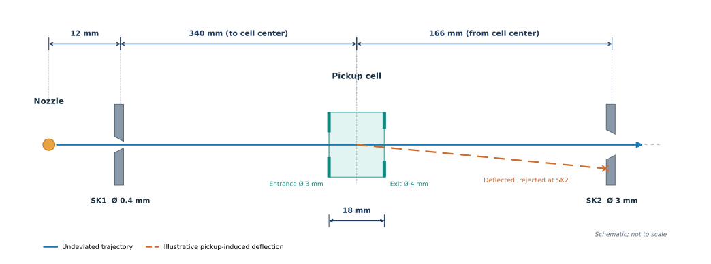

# HND Pickup and Skimmer-Transmission Simulation

A simplified Python model of **Kr pickup by helium nanodroplets (HNDs)**, pickup-induced transverse deflection, and geometrical transmission through the pickup-cell exit and second skimmer (SK2).

## Experimental Setup



*Experimental geometry used in the simulation (not to scale).*

The simulations are based on a helium nanodroplet source operating
at a stagnation pressure of 50 bar, with a 5 µm nozzle diameter
and a nozzle temperature of 16 K.

The initial HND sizes are sampled from a lognormal distribution
with a mean of 9,678 He atoms and a logarithmic width of
σ_lnN = 0.585431.

The initial size distribution is prescribed rather than
calculated directly from the expansion conditions. The beamline
dimensions and aperture sizes are specified in `geometry.py`.
## Model

Kr pickup is estimated using a **Kuma-type analytical shrinkage model**.

A simplified Monte Carlo approach samples initial HND sizes, applies an effective transverse Gaussian momentum kick, and calculates geometrical transmission through the pickup-cell exit and SK2.

Two mass approximations are compared:

- **Initial mass:** The droplet mass is kept fixed at its initial value during the deflection calculation.
- **Midpoint mass:** The effective mass is the average of the initial and estimated final masses.

Both approximations include Kr pickup and the associated deflection. A separate **no-Kr reference** represents purely geometrical transmission without pickup-induced deflection.

This is an exploratory model, not an event-by-event pickup simulation. Transmission estimates are not experimentally calibrated efficiencies. The effective He-loss coefficient is derived from interpolated HeDopant results.

## Installation and Usage

Install the required Python packages:

```bash
python -m pip install -r requirements.txt
```

Run the simulation:

```bash
python main.py
```

Simulation parameters can be modified in `config.py`, while beamline dimensions are defined in `geometry.py`.

The results are saved in `output/`, including CSV data, a two-page PDF report, and PDF/PNG figures.

## Reference Results

For 1,000,000 simulated HNDs, seed 42, and a local Kr pressure of 1.3 × 10⁻³ mbar:

| Model                         | SK2 transmission |
|-------------------------------|-----------------:|
| No Kr (geometrical reference) |           43.88% |
| Initial mass                  |           27.46% |
| Midpoint mass                 |           15.16% |

The calculations suggest preferential transmission of initially larger HNDs under the assumed pickup-induced deflection model.

## License

This project is licensed under the MIT License.
See [LICENSE](LICENSE) for details.